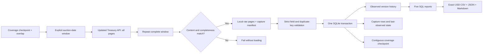

# Treasury Auction Ledger

**Incremental Treasury auction ETL with exact dollar amounts, observed correction history and recoverable checkpoints.**

[](https://github.com/LuciferDataEngineer/treasury-auction-ledger/actions/workflows/check.yml)

A focused Python and SQLite pipeline that refreshes overlapping auction-date windows, preserves raw evidence, and applies each accepted observation once. It tracks corrections, disappearance and reappearance without confusing them with official Treasury events.

**Observed release:** 61 auction records for **1 October–19 November 2026**, acquired **20 November in Melbourne**. This is a working local implementation with real public-source validation and explicitly synthetic recovery drills. No subscription, API key, cloud deployment or hosted schedule is required.

**Validated locally:** 44 offline tests passed; exact SQL amounts matched independent Decimal calculations. A real 14-day refresh observed 18 unchanged auctions without adding versions.

[Observed report](examples/observed/report.md) · [Validation evidence](docs/VALIDATION.md) · [Source contract](docs/SOURCE.md) · [SQL queries](sql)

## The problem

An auction feed is mutable. An announcement can gain results later, reopenings reuse the same security identifier, and a date field called `record_date` may not mean “last updated.” Appending only records after the largest date can miss corrections or skip auctions entirely. A failed refresh must also leave the previous database and checkpoint intact.

This project treats each extraction as a complete **bounded query window**, compares two reads, and reconciles that window transactionally. Its key is **competitive auction date + CUSIP**, not CUSIP alone. It preserves the history of what this collector actually observed.

The topic is current: Treasury's **4 November 2026 refunding statement** announced $125 billion of securities to refinance approximately $97 billion of maturities. This repository demonstrates the data-engineering work behind traceable auction reporting; its totals are not net borrowing or an estimate of the policy's effects. [Treasury primary statement](https://home.treasury.gov/news/press-releases/sb0678/).

## Source details that change the design

The live source review found that the dataset's **updated** endpoint is `treasury_securities_auctions_v2`; the legacy `auctions_query` probe stopped at 22 October and had missing result fields. The schemas are different. The updated endpoint is documented on the [official dataset page](https://fiscaldata.treasury.gov/datasets/treasury-securities-auctions-data/).

In all 61 observed records, `record_date` equalled `issue_date`; six issue dates were later than the extraction window's end. The pipeline therefore filters by **`comp_auction_close_date`**, advances a successfully reconciled window boundary, and refreshes a configurable overlap. It never uses `record_date` or the maximum row date as an update watermark.

Fiscal Data can aggregate some `fields` projections, so acquisition requests **all fields**. Literal `"null"` strings normalize to SQL NULL. Missing inflation/floating-rate flags stay missing. The published bid-to-cover ratio excludes SOMA; it is preserved rather than recomputed from grand totals. [API documentation](https://fiscaldata.treasury.gov/api-documentation/), [field dictionary and detailed source findings](docs/SOURCE.md).

## Architecture



### Stack and rationale

| Layer | Technology | Reason |
|---|---|---|
| Acquisition | Python standard-library HTTP and JSON | Credential-free bounded requests with inspectable pagination and byte provenance |
| Validation | `datetime`, `Decimal`, SHA-256 | Calendar-date contracts, exact money and reproducible evidence |
| Storage | SQLite WAL, foreign keys, explicit transactions | Appropriate for this small feed; one-effect retries, concurrent readers and atomic history/checkpoint updates |
| Reporting | SQL, CSV, JSON, Markdown | Portable outputs with explicit units and transparent grouping |
| Tests | `unittest`, mocked HTTP, fault injection | Deterministic drift, rollback, stale replay and recovery scenarios |
| CI | GitHub Actions, Python 3.12 and 3.14 | Offline checks on push and pull request; no credentials or hosted extraction schedule |

Requires **Python 3.12+ on macOS/Linux**, or Windows through WSL. Report publication uses POSIX advisory locks. There are no pip dependencies. This implementation is a local engineering portfolio project, not an investment recommendation or a deployed production service.

## Run the offline demonstration

```sh
git clone https://github.com/LuciferDataEngineer/treasury-auction-ledger.git
cd treasury-auction-ledger
python3 -W error::ResourceWarning -m unittest discover -s tests -v
python3 demo.py --work-dir data/demo
```

Open `data/demo/report/report.md` and `data/demo/validation.json`. All demo securities, dates, amounts and changes are **SYNTHETIC**.

| Synthetic observation | Inserted | Revised / returned | Newly absent | Unchanged input rows |
|---|---:|---:|---:|---:|
| Baseline | 3 | 0 | 0 | 0 |
| Correction and missing record | 1 | 1 | 1 | 0 |
| Reversion and reappearance | 0 | 2 | 0 | 1 |

The drill injects a storage failure midway through the second load. History and checkpoint remain unchanged, then the same capture succeeds after the fault is removed. It closes/reopens the database and replays the older accepted capture without reverting newer state. A new stale overlapping capture is rejected. Final state: **4 current auctions, 8 history versions, 3 accepted captures**.

This demonstrates A → B → A value reversion and a missing row returning. These are simulated engineering cases, not observed Treasury revisions. Existing demo/output folders are preserved; choose a new directory for another run.

## Run the real pipeline

The following bootstrap uses the release's explicit historical window. `plan` performs no network requests. `sync` fetches every page twice, saves verified evidence, and loads it:

```sh
python3 pipeline.py plan --start 2026-10-01 --as-of 2026-11-19
python3 pipeline.py sync --start 2026-10-01 --as-of 2026-11-19
python3 pipeline.py report --output data/report-1
```

After bootstrap, omit `--start`. A repeated refresh of that endpoint date reloads the final 14 calendar days by default:

```sh
python3 pipeline.py plan --as-of 2026-11-19 --lookback-days 14
# Expected window: 2026-11-06 through 2026-11-19.
python3 pipeline.py sync --as-of 2026-11-19 --lookback-days 14
python3 pipeline.py report --output data/report-2
```

On later runs, set `--as-of` to the explicit auction-date boundary you want to inspect. It is a requested date, not a promise that Treasury has published every result. Future issue dates are valid. Announcement-only records retain NULL results until a later refresh observes them.

For explicit windows, source capture and warehouse loading are separate commands:

```sh
manifest_path="$(python3 pipeline.py fetch --start 2026-10-01 --end 2026-11-19 --data-dir data)"
python3 pipeline.py load "$manifest_path" --db data/auctions.sqlite
# Exact replay: no network request, no additional facts, versions or checkpoint change.
python3 pipeline.py load "$manifest_path" --db data/auctions.sqlite
```

Use `--db` to choose another warehouse. Live acquisition supports at most **93 inclusive days, 1,000 rows and 10 pages per pass**. Large catch-up intervals must be processed in adjacent chunks. Explicit historical backfills are supported when they overlap or touch the retained interval; disconnected windows are rejected rather than creating a hidden coverage gap.

## Observed real output

The **1 October–19 November** capture contains 47 Bills, 10 Notes and 4 Bonds, including 38 reopenings and 23 new issues. All 61 records had published results and awarded amounts at collection time.

| Metric | Observed value | Unit / meaning |
|---|---:|---|
| Auction records | 61 | Distinct auction-date/CUSIP keys |
| Amount offered | 4,809,000,000,000.00 | USD offered across auctions |
| Grand total par awarded | 5,158,651,593,400.00 | USD par awarded, including applicable outside-offering amounts |
| Grand total par recognized | 13,530,509,725,600.00 | USD par recognized, not cash received |
| Issue dates after window end | 6 | Valid future issuance dates |
| Observed corrections in initial capture | 0 | One acquisition cannot establish a revision trend |

Offered and awarded totals need not match. Auctions can reopen an existing security; these sums do not represent unique securities, outstanding debt, net financing or cash proceeds. Source rates have 47 Rate, 13 Yield and 1 Discount Margin expressions; they are never blended into a single average.

The instrument report groups by source security type, inflation flag, floating-rate flag and bid expression. For example, Bill rows with missing flags and Bill rows explicitly marked No/No remain separate groups; that is a missingness distinction, not two inferred economic types.

Published evidence is in [examples/observed](examples/observed). The API is mutable, so later executions may differ. Raw responses remain under ignored `data/`; exact historical re-execution requires that retained local cache. Public aggregates and synthetic tests are included in Git.

## Schema, grain and units

DDL: [sql/schema.sql](sql/schema.sql). Raw source values and metadata are retained in content-addressed JSON files; normalized facts contain only the selected analytical fields.

| Table/view | Grain | Purpose |
|---|---|---|
| `captures` | Unique `capture_id`, durable `load_sequence` | Accepted request window, acquisition time, raw/row hashes, load counters and recovery order |
| `capture_rows` | Capture + auction date + CUSIP | Raw and projected row fingerprints for every accepted input key |
| `auction_versions` | Auction date + CUSIP + version number | Half-open observed-time intervals, present/absent state and normalized facts |
| `auction_observations` | Auction date + CUSIP | Last acquisition that checked/observed the key's state, including unchanged rows or repeated absence |
| `checkpoint` | Singleton | Contiguous retained query interval and last successfully loaded capture |
| `current_auctions` | One open present version per key | Latest accepted observed facts and their last-observed provenance |

`observed_from`/`observed_to` are **collector observation times**, not Treasury revision timestamps. The timestamp is taken before acquisition begins. `load_sequence` records successful ingestion order separately from capture time. Source timestamps do not prove when a change occurred between observations.

| Normalized fields | Definition |
|---|---|
| `auction_date`, `cusip` | Competitive-auction close date + nine-character uppercase security identifier |
| `source_record_date`, `issue_date`, `maturity_date` | ISO calendar dates; issue/maturity may be after the capture boundary |
| `security_type`, `security_term` | Supported Bill/Note/Bond and source term label |
| `offering_cents`, `awarded_cents`, `recognized_cents` | Exact integer USD cents parsed with Decimal; optional results remain NULL |
| `high_rate`, `high_yield`, `high_discnt_margin` | Canonical decimal text in the source's percentage units; retain type distinctions and signed values |
| `bid_to_cover_ratio` | Published dimensionless ratio; not recomputed from grand totals |
| `reopening`, `inflation_protected`, `floating_rate` | Yes / No / NULL, with missingness retained |
| `comp_bid_expression` | Source Rate / Yield / Discount Margin text; new labels remain visible |
| `pdf_filenm_comp_results` | Published result filename or NULL; no document is fetched by the pipeline |

A row requires a valid composite key, dates with `auction_date <= issue_date <= maturity_date`, supported security type, term and offered amount. Money is nonnegative, fixed-point with at most two fractional digits and at most USD 10 trillion per row. Rate/ratio text supports at most six fractional digits and absolute values up to 1,000; the ratio must be nonnegative. Values beyond those explicit supported bounds fail for review. No float conversion is used for money.

Every duplicate key or invalid row rejects the **whole capture**. Partial valid-row loading could otherwise create false disappearance records, so this pipeline deliberately uses batch rejection rather than partial quarantine. Stored raw evidence remains available for inspection; logs report the failure and the checkpoint does not advance.

## Report definitions

All report queries run in one reader transaction. SQL sums integer cents; the export formatter writes exact `*_usd` decimal strings. CSVs retain headers even when there are no rows. JSON includes column schemas and coverage labels.

| Query | Scope |
|---|---|
| `instrument_summary.sql` | Current auction counts, offered/awarded/recognized par, result coverage counts and reopenings by source instrument flags and bid expression |
| `daily_totals.sql` | Current counts and amounts by competitive-auction date; explicit count of non-NULL awarded amounts |
| `revision_history.sql` | Versions after version 1, including observed absence and return; no inferred cancellation |
| `quality.sql` | Current/history/capture counts, missing results, record-date differences and issue dates after the retained interval |
| `capture_audit.sql` | Accepted extraction windows, hashes and change counters in durable ingestion order |

SQLite indexes enforce one open version per key and support window, date/type and capture lookups. At extreme accumulated volumes SQLite's 64-bit integer SUM can overflow; it fails rather than silently switching these queries to floating-point arithmetic. No large-workload capacity claim is made.

## Retry, concurrency and history guarantees

- `BEGIN IMMEDIATE` commits capture evidence, row mappings, version changes, last-observed state and checkpoint together. Foreign keys and conservation checks run inside that transaction; a failure rolls everything back.
- Replaying an existing capture ID verifies its immutable evidence and returns the stored load result. It makes no new version and does not revert later changes. Reusing an ID with altered evidence fails.
- A new acquisition has a distinct capture ID even when content is identical. Unchanged facts gain observation provenance without a new version. A genuine A → B → A observation creates both transitions.
- New captures at or before a previously accepted intersecting window's acquisition time are rejected. Newer narrow refreshes can make an older wider capture stale; this conservative policy avoids overwriting more recent observations.
- Missing keys become `absent_from_observation` only inside the complete refreshed interval. Other dates are unaffected. Repeated absence creates no additional version; reappearance creates a new present version.
- The checkpoint records successful query coverage, including stable empty windows. It does not jump over disconnected intervals or follow future issue dates. A default 14-day overlap can miss older corrections; deliberately refresh wider historical windows when needed.

Two matching API passes improve evidence of stability but cannot provide an upstream transaction snapshot or prove that Treasury published every expected auction. Current state can mix acquisition times across windows; inspect the capture audit before comparing periods. Rates are source observations, not a live market price feed.

## Recovery and cleanup

For a failed transaction, repair the cause and reload the **same verified sidecar**. On source drift or network failure, retry the entire acquisition later; do not load a partial response. On raw checksum failure, preserve the damaged directory and acquire into a new data directory. The mutable API cannot reproduce old bytes by hash.

Back up the SQLite database with its **online backup API**, and retain the complete raw/manifests directory. Do not copy only the `.sqlite` file while WAL writers are active. To produce a local database backup after the normal CLI has exited:

```sh
python3 - <<'PY'
from pathlib import Path
import sqlite3
from contextlib import closing
source = Path('data/auctions.sqlite')
target = Path('data/auctions-backup.sqlite')
if not source.exists() or target.exists():
    raise SystemExit('Source must exist and backup target must be new')
with closing(sqlite3.connect(source)) as original:
    with closing(sqlite3.connect(target)) as backup:
        original.backup(backup)
PY
```

For a logical rebuild, export the **accepted capture IDs ordered by `load_sequence`** from the backed-up `captures` table, then load those sidecars into a new database in that order. Do not replay every cached sidecar or sort solely by timestamp: the cache can contain rejected acquisitions, and accepted explicit backfills may have a different successful ingestion order. The test suite reconstructs all business/audit tables from recorded order. Portable sidecars resolve raw paths relative to their data directory; the local warehouse's stored absolute manifest path may need mapping to the relocated manifest folder.

The initial schema has no in-place migration tooling. Preserve old databases before future schema changes. Generated report directories are published atomically for cooperating local writers; validation evidence is written afterward, so a failed evidence write requires a new output directory. There are no cloud resources to clean up. Remove only your chosen generated data directory when its history/backups are no longer needed.

## Validation and interview discussion

[docs/VALIDATION.md](docs/VALIDATION.md) records deterministic tests, the real bounded API check, independent Decimal/SQL reconciliation, exact replay and synthetic recovery. GitHub CI runs offline tests on Python 3.12 and 3.14. No source schedule, production deployment, distributed recovery, investment model or throughput SLA was tested.

Useful interview topics:

1. How source contracts invalidated a plausible but incorrect `record_date` watermark.
2. Why complete overlapping windows, all-field extraction and two-pass checks matter for a mutable paginated API.
3. How acquisition identity differs from business-row identity, including A → B → A reversion.
4. Why partial quarantine would be unsafe before inferring observed absence.
5. How observed-time history, stale-window rejection and contiguous coverage interact with explicit backfills.
6. Why exact par amounts, source ratios and rate-type separation protect analytical meaning.
7. How durable ingestion order and transaction failure tests make recovery reviewable.

Original implementation and fixtures: [MIT](LICENSE). Source access dates, permissions, definitions and primary links: [docs/SOURCE.md](docs/SOURCE.md). Future proposals—**not implemented**—include an approved scheduler, alert thresholds and larger analytical storage if measured workload requires them.
